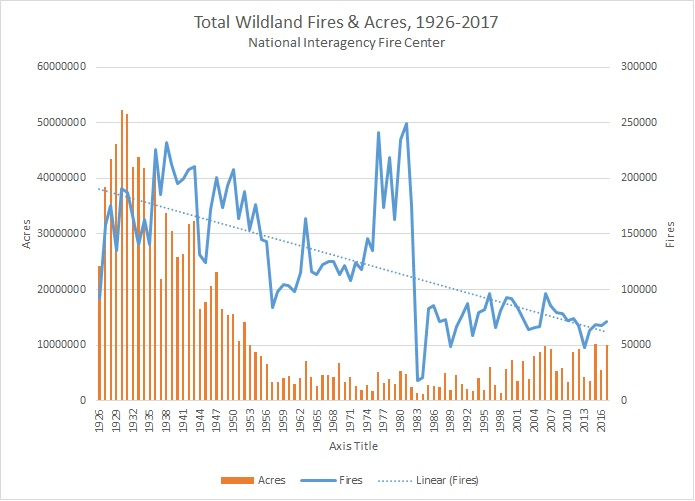

# Wildfire Trends & Temperature Anomalies: 1926–2024

This data visualization project combines wildfire‐incident data from the National Interagency Fire Center (NIFC) with the north hemisphere temperature anomalies from the National Oceanic and Atmospheric Administration (NOAA) to explore how wildfire ignitions and burned area have evolved over the last centure and whether average fire size correlates with rising temperatures.

# Load the necessary libraries

The following data visualization requires these library packages.

We rely on tidyverse for data manipulation, load **ggplot2** for plotting, **dplyr**/​**readr** for data wrangling and import, **zoo** for 5-year moving averages, **RColorBrewer** for color-blind palettes, **scales** for axis formatting, **purrr** for functional helpers, **patchwork** for combining plots, **ggfittext** for auto-sizing labels, and **knitr** for dynamic report generation.

```{r}
#| label: Load necessary libraries
#| warning: false
#| message: false

library(ggplot2)
library(dplyr)
library(zoo)
library(RColorBrewer)
library(scales)
library(patchwork)
library(readr)
library(knitr)
library(purrr)
library(ggfittext)
```

## Original Visualization

Below is the original chart published by [E. Calvin Beisner, 2022](https://cornwallalliance.org/misleading-infographic-about-climate-change-and-wildfires/).

The data originates from the NIFC. This snapshot serves as a baseline for comparison, highlighting the chart’s heavy visual clutter and scale confusion that our improved version aims to address.

```{r}
#| label: Display Calvin's visualization
#| fig-cap: "Calvin's visualization"
#| fig-width: 24
#| fig-height: 10


```

## Datasets Used

Using a custom scraper, we saved the annual number of U.S. wildfires and total acres burned to `wildfire_data.csv`, and obtained the raw CSV data `temp_anomaly.csv` that contains annual temperature anomalies in the north hemisphere.

> **Source:**
>
> <https://www.nifc.gov/fire-information/statistics/wildfires>
>
> <https://web.archive.org/web/20201224043154/https:/www.nifc.gov/fireInfo/fireInfo_stats_totalFires.html>
>
> <https://data.giss.nasa.gov/gistemp/>

## Load Data

Next, we import and read both CSV files. We suppress messages for a cleaner output.

```{r}
#| label: Import and load all required data
#| message: FALSE

wildfire_df <- read_csv("datasets/wildfire_data.csv")

temp_raw <- read_csv("datasets/temp_anomaly.csv",
  skip       = 1,
  na         = c("***"),
  col_types  = cols()
)
```

## Data Cleaning and Data Preprocessing

Before we build our infographic, we need to prepare both the wildfire and temperature anomaly data.

After loading the data, we need to do data preprocessing before plotting. First, we ensure the wildfire data is sorted by year and then compute 5-year rolling averages for the number of fires (`Fires_MA`) and total acres burned (`Acres_MA`), from which we derive the average acres burned per fire (`Acres_per_Fire`).

Next, we clean the raw temperature data by renaming the annual “J–D” column to `TempAnomaly`, forcing it to numeric, calculating its 5-year rolling mean (`Temp_MA`), and filtering the series to our analysis window (1926–2024). We merge these two cleaned tables into a single data frame `df` using a left join on `Year`.

To support consistent axis formatting, we compute a sequence of four-year breaks (`year_breaks`) and define a helper function `year_abbr()` that formats years as two-digit strings with an apostrophe.

Finally, we perform sanity checks: we warn if any years in 1926–2024 are missing from the temperature data and message the count of `NA` values in the early rolling means, ensuring data completeness before visualization.

```{r}
#| label: Conduct data cleaning and data preprocessing


# Ensure wildfire data sorted by Year
wildfire_df <- wildfire_df %>%
  arrange(Year)

# Compute 5-year rolling means and per-fire acreage
wildfire_df <- wildfire_df %>%
  mutate(
    Fires_MA       = rollmean(Fires, 5, fill = NA, align = "right"),
    Acres_MA       = rollmean(Acres, 5, fill = NA, align = "right"),
    Acres_per_Fire = Acres_MA / Fires_MA
  )

temp_df <- temp_raw %>%
  # Rename annual column to TempAnomaly
  rename(TempAnomaly = `J-D`) %>%
  select(Year, TempAnomaly) %>%
  # Ensure data type is numeric
  mutate(TempAnomaly = as.numeric(TempAnomaly)) %>%
  # Compute 5-year rolling mean for TempAnomaly
  mutate(Temp_MA = rollmean(TempAnomaly, 5, fill = NA, align = "right")) %>%
  filter(Year >= 1926, Year <= 2024)

df <- wildfire_df %>%
  left_join(temp_df, by = "Year")

# Total warming from 1926 to 2024
warming <- temp_df %>%
  summarise(
    start = TempAnomaly[Year == min(Year)],
    end   = TempAnomaly[Year == max(Year)]
  ) %>%
  pull(end - start)

# Common x-axis breaks for plotting
year_breaks <- seq(min(df$Year), max(df$Year), by = 4)

# Function that bbreviates years like 2001 → "01'"
year_abbr <- function(x) sprintf("%02d'", x %% 100)

# Missing years in temperature data
missing_years <- setdiff(1926:2024, temp_df$Year)
if (length(missing_years) > 0) {
  warning(
    "These years are missing from the anomaly file: ",
    paste(missing_years, collapse = ", ")
  )
}

# NA rolling means in early years
na_count <- sum(is.na(temp_df$Temp_MA))
if (na_count > 0) {
  message(
    "There are ", na_count, " NA anomalies in 1926–2017."
  )
}
```

## Define Base Colors and Style

We have decided to establish a consistent visual style and a color‐blind–friendly palette that will be applied across all of our plots.

By centralizing our theme settings and color assignments here, we ensure that every component of the infographic shares a unified look and feel, making comparisons across panels seamless and visually coherent.

```{r}
#| label: Define Base Colors and Style
#| warning: false
#| message: false

# Define unified style and colors
base_theme <- theme_minimal(base_family = "sans") +
  theme(
    panel.grid.major = element_line(
      color = "grey80",
      linetype = "dashed",
      size = 0.5
    ),
    panel.grid.minor = element_blank(),
    plot.subtitle = element_text(size = 10),
    plot.caption = element_text(size = 8, hjust = 0),
    axis.text.x = element_text(angle = 45, hjust = 1)
  )

# Line colors for each line graph
line_cols <- brewer.pal(4, "Dark2")
ratio_col <- line_cols[1]
fires_col <- line_cols[2]
temp_col <- line_cols[3]
acres_col <- line_cols[4]
```

## Era Shading & Annotations

We decided to define and render “era” backgrounds and labels to contextualize major shifts in U.S. wildfire policy and outcomes over time in our inforgraphic.

We first define an `eras` data frame with start/end years, pastel fill colors, and brief labels. Then, using `Map()`, we create two sets of ggplot annotations—semi-transparent rectangles (`era_rects`) and boxed text labels (`era_labels_box`).

Finally, the `add_eras()` helper bundles these layers so any plot can add consistent era shading with a single call.

```{r}
#| label: Era Shading & Annotations

# Define era periods
eras <- data.frame(
  xmin = c(1926, 1936, 1955, 1977, 1983, 2015),
  xmax = c(1936, 1955, 1977, 1983, 2015, 2024),
  fill = brewer.pal(6, "Pastel2"),
  label = c(
    "(1926-1936)
Pre-Smokey Bear
& the Dust Bowl",
    "(1936-1955)
Smokey Bear
& Implementation
of 10 a.m. Policy",
    "(1955-1977)
10 a.m. Policy remained in force,
federal budgets for wildfire grew
rapidly in the post-war boom",
    "(1977 - 1983)
New national
fire‐reporting
system,
eliminated
duplicates &
stricter record
criteria",
    "(1983 - 2015)
Total area burned trends ↑,
ignition counts stay flat or fall,
indicating longer fire seasons",
    "(2015 - 2024)
Successful
ignition‐prevention
campaigns & better
infrastructure catch
to small fires early"
  ),
  vjust = c(2.0, 1.875, 3.125, 1.75, 2.75, 1.375),
  hjust = c(0.5, 0.5, 0.65, 0.5, 0.75, 0.5),
  stringsAsFactors = FALSE
)

# Create shaded rectangle annotations for each era
era_rects <- Map(function(xmin, xmax, fill) {
  annotate("rect",
    xmin = xmin, xmax = xmax,
    ymin = -Inf, ymax = Inf,
    fill = fill, alpha = 0.40
  )
}, eras$xmin, eras$xmax, eras$fill)

# Create boxed text annotations for each era
era_labels_box <- Map(function(xmin, xmax, lab, vj, hj) {
  annotate("label",
    x             = (xmin + xmax) / 2,
    y             = Inf,
    label         = lab,
    vjust         = vj,
    hjust         = hj,
    size          = 5,
    fill          = "white",
    colour        = "black",
    label.size    = 0.2,
    label.padding = unit(0.35, "lines"),
    label.r       = unit(0.1, "lines")
  )
}, eras$xmin, eras$xmax, eras$label, eras$vjust, eras$hjust)

# Helper function to add rectangle and/or label annotations
add_eras <- function(rects = TRUE, labels = TRUE) {
  ann <- list()
  if (rects) ann <- c(ann, era_rects)
  if (labels) ann <- c(ann, era_labels_box)
  ann
}
```

## Create Individual Graphs: Average Acres per Fire

In the “Average Acres per Fire” graph, we plot the 5-year moving average of acres burned per fire over time, with historical era bands added via `add_eras(rects = TRUE, labels = TRUE)`.

A single `geom_line()` draws the series and has its legend suppressed. We lock in that color mapping with `scale_colour_manual()`, then format the y-axis using `scale_y_continuous()`—naming it “Acres / Fire,” adding comma separators, and a small vertical buffer so the line never touches the frame.

The x-axis uses `scale_x_continuous()` with pre-computed four-year breaks and two-digit labels (e.g. “‘26”), and we apply `base_theme` plus bold, size-14 axis titles to keep the panel visually aligned with the rest of the infographic.

```{r}
#| label: Construct Average Acres per Fire Graph
#| warning: false
#| message: false

p_ratio <- ggplot(df, aes(Year, Acres_per_Fire)) +
  add_eras(rects = TRUE, labels = TRUE) +
  geom_line(aes(colour = "Acres / Fire"), size = 1.0, show.legend = FALSE) +
  scale_colour_manual(
    name   = NULL,
    values = c("Acres / Fire" = ratio_col)
  ) +
  scale_y_continuous(
    name   = "Acres / Fire",
    labels = comma,
    expand = expansion(mult = c(0, .05))
  ) +
  scale_x_continuous(
    breaks = year_breaks,
    labels = year_abbr,
    expand = c(0, 0)
  ) +
  theme(
    base_theme,
    legend.text = element_text(size = 14),
    legend.title = element_text(size = 16),
    legend.key.size = unit(1.2, "lines"),
    legend.position = c(.85, .95),
    legend.justification = c(0, 1),
    legend.background = element_blank(),
    axis.title.x = element_text(size = 14, face = "bold"),
    axis.title.y = element_text(color = "black", size = 14, face = "bold"),
  )
```

## Create Individual Graphs: Annual Mean Temperature Anomaly

In the “Annual Mean Temperature Anomaly” panel, we plot Year against the 5-year rolling mean of temperature anomalies (`Temp_MA`) and overlay our era shading with `add_eras()`.

A dashed horizontal line at y = 0 marks the baseline, and an `annotate("label",…)` callout box highlights a key insight. The anomaly series itself is drawn as a single purple line (`geom_line(show.legend = FALSE)`), with its color fixed via `scale_colour_manual()`.

We format the y-axis with 0.2 °C breaks, simple numeric labels, and a slight expansion so the line never touches the frame, then reuse our four-year x-axis breaks and two-digit labels—hiding x-axis text and ticks to keep only the lower panels time-labeled. Finally, we apply `base_theme` for uniform grid and font styling and bold the y-axis title in black for clarity.

```{r}
#| label: Construct Annual Mean Temperature Anomaly Graph

p_temp <- ggplot(df, aes(Year, Temp_MA)) +
  add_eras(rects = TRUE, labels = FALSE) +
  geom_hline(
    yintercept = 0,
    linetype   = "dashed",
    size       = 0.5,
    colour     = "grey50"
  ) +
  annotate("label",
    x = 1928,
    y = 0.5,
    label = "Although average acres burned per fire was relatively high during
this period, temperature anomalies increased slightly or decreased.",
    hjust = 0,
    size = 6,
    fill = "white",
    colour = "black",
    label.size = 0.2,
    label.padding = unit(0.35, "lines"),
    label.r = unit(0.1, "lines")
  ) +
  annotate("label",
    x = 1976,
    y = 1.0,
    label = "Temperature continues to increase, yet wildfires remain relatively
low. There is no resurgence of fire sizes in modern climate change.",
    hjust = 0,
    size = 6,
    fill = "white",
    colour = "black",
    label.size = 0.2,
    label.padding = unit(0.35, "lines"),
    label.r = unit(0.1, "lines")
  ) +
  annotate("label",
    x = 1994,
    y = 0.125,
    label = "Across almost a century, wildfire metrics fell significantly while
average global temperature anomaly rose steadily.",
    hjust = 0,
    size = 6,
    fill = "white",
    colour = "black",
    label.size = 0.2,
    label.padding = unit(0.35, "lines"),
    label.r = unit(0.1, "lines")
  ) +
  geom_line(aes(colour = "Temperature Anomaly (°C)"),
    size = 1.0,
    show.legend = FALSE
  ) +
  scale_colour_manual(
    name   = NULL,
    values = c("Temperature Anomaly (°C)" = temp_col)
  ) +
  scale_y_continuous(
    name   = "Temperature Anomaly (°C)",
    breaks = seq(0, ceiling(max(df$TempAnomaly) * 10) / 10, by = 0.2),
    labels = function(x) paste0(x),
    expand = expansion(mult = c(0, .05))
  ) +
  scale_x_continuous(
    breaks = year_breaks,
    labels = year_abbr,
    expand = c(0, 0)
  ) +
  theme(
    base_theme,
    legend.text = element_text(size = 14),
    legend.title = element_text(size = 16),
    axis.text.x = element_blank(),
    axis.ticks.x = element_blank(),
    axis.title.x = element_blank(),
    legend.key.size = unit(1.2, "lines"),
    legend.position = c(.725, .25),
    legend.justification = c(0, 1),
    legend.background = element_blank(),
    axis.title.y = element_text(color = "black", size = 14, face = "bold")
  )
```

## Create Individual Graphs: Number of U.S. Wildfires

In the “Number of U.S. Wildfires” panel, we start by mapping `Year` to the x-axis and the 5-year moving average of fire counts (`Fires_MA`) to the y-axis, then overlay our era shading (without labels) using `add_eras(rects = TRUE, labels = FALSE)`.

A single `geom_line()` draws the trend in the color `fires_col` at a line width of 1.0. Raw wildfire counts are converted into thousands (e.g. 200 000 → “200 K”). Additionally, we reuse our shared four-year breaks and two-digit labels on the x-axis for this graph.

```{r}
#| label: Construct Number of U.S. Wildfires Graph

p_fires <- ggplot(df, aes(Year, Fires_MA)) +
  add_eras(rects = TRUE, labels = FALSE) +
  geom_line(color = fires_col, size = 1.0) +
  scale_y_continuous(
    name = "Number of U.S. Wildfires",
    labels = label_comma(
      scale = 1e-3, # divide raw values by 1,000
      suffix = "K", # append “K”
      accuracy = 1
    ),
    expand = expansion(mult = c(0, .05))
  ) +
  scale_x_continuous(
    breaks = year_breaks,
    labels = year_abbr,
    expand = c(0, 0)
  ) +
  labs(subtitle = "Number of Wildfires in the US") +
  theme(
    base_theme,
    axis.title.x = element_text(size = 14, face = "bold"),
    axis.title.y = element_text(color = "black", size = 14, face = "bold")
  )
```

## Create Individual Graphs: Areas Burnt 

In the “Areas Burnt (Acres)” panel, we map `Year` to the x-axis and the 5-year moving average of burned acreage (`Acres_MA`) to the y-axis, then overlay our era shading with `add_eras(rects = TRUE, labels = FALSE)`. Raw acre counts are converted into millions (e.g. 40 000 000 → “40 M”). Additionally, we reuse our four-year breaks and two-digit labels for the x-axis like the previous graphs as well.

```{r}
#| label: Construct Areas Burnt Graph

p_acres <- ggplot(df, aes(Year, Acres_MA)) +
  add_eras(rects = TRUE, labels = FALSE) +
  geom_line(color = acres_col, size = 1.0) +
  scale_y_continuous(
    name = "Areas Burnt (Acres)",
    labels = label_comma(
      scale = 1e-6, # divide raw values by 1,000,000
      suffix = "M", # append “M”
      accuracy = 1
    ),
    expand = expansion(mult = c(0, .05))
  ) +
  scale_x_continuous(
    breaks = year_breaks,
    labels = year_abbr,
    expand = c(0, 0)
  ) +
  labs(subtitle = "Areas Burnt due to Wildfires in the US") +
  theme(
    base_theme,
    axis.title.x = element_text(size = 14, face = "bold"),
    axis.title.y = element_text(color = "black", size = 14, face = "bold")
  )
```

## Combine Panels & Add Title and Sources

In this closing block, we use **patchwork** to merge our four panels into a single infographic: `p_ratio` sits above `p_temp`, while `p_fires` and `p_acres` sit side by side below.

With `plot_layout(heights = c(1.5, 1.5, 1.0))`, the top two rows receive extra vertical emphasis compared to the bottom row.

We then call `plot_annotation()` to add a descriptive title and source caption in one step, and apply a final `theme()` adjustment to center and enlarge the title (20 pt, bold) and format the caption (12 pt, left-aligned), creating a well-balanced, publication-ready graphic.

```{r}
#| label: Construct all graphs together and add title and sources
#| include: false

final_plot <- (p_ratio / p_temp) / (p_fires | p_acres) +
  plot_layout(heights = c(1.5, 1.5, 1.0)) +
  plot_annotation(
    title = paste0("Trends in U.S. Wildfires and Temperature Anomalies",
                   "from 1926 to 2024"),
    caption = paste0(
      "Sources:\n",
      "Wildfires: NIFC\n",
      "Temperature Anomalies: NOAA"
    )
  ) & theme(
  plot.title             = element_text(size = 20, face = "bold", hjust = 0.5),
  plot.caption           = element_text(size = 14, hjust = 0),
  plot.caption.position  = "plot"
)
```

## Export Plot

In this final code chunk, we call `print(final_plot)` to render the assembled infographic. We then use `ggsave()` to export the infographic as a PNG file.

```{r}
#| label: Save the final infographic into a PNG image
#| warning: false
#| message: false
#| fig-width: 24
#| fig-height: 14
#| #| fig-cap: "Finalized Infographic"

print(final_plot)
ggsave(
  filename = "images/wildfire_infographic.png",
  plot     = final_plot,
  width    = 24,
  height   = 14,
  dpi      = 600
)
```
